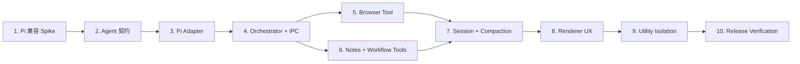

# Nia Pi Agent Core 实施计划

> **执行要求：** 实施时使用 `executing-plans`；每个任务按 RED -> GREEN -> REFACTOR 推进。不要跨过安全测试直接连接真实工具。

**目标：** 将 Pi Agent Runtime 作为 Nia Agent 模式唯一的会话和工具循环内核，同时保留 Auris 对 Provider 凭据、上下文附件、浏览器权限、笔记 revision/审核、工作流审批和本地历史的所有权。

**架构：** Renderer 只发送版本化的 session/turn intent。Electron main 中的 `NiaAgentOrchestrator` 创建或恢复 `NiaPiAdapter`，把 Pi 事件映射为 Nia 事件，并把 custom tool call 转发到 main-owned capability。P0/P1 在 main 内验证；P3 再把 Pi session 移入一会话一进程的 utility runtime。

**技术栈：** Electron 41、Node CJS/ESM、React 19、TypeScript 5.9、Vitest 4、Pi `@earendil-works/pi-*`、Zod 4、现有 Browser dispatcher、Notes MCP workbench contract 和 Workflow facade。

**设计规格：** `docs/superpowers/specs/2026-08-16-nia-pi-agent-core-design.md`

---

## 影响范围声明

本计划将来会修改 `electron/main.cjs` 和 `electron/preload.cjs`，因为 Nia Agent 是明确的 Electron 主进程能力。修改必须限制为：

- 启动/关闭 Nia Agent Orchestrator；
- 暴露版本化 Nia IPC 命令和事件；
- 注入现有 Browser、Notes 和 Workflow capability；
- 启动/回收 Nia utility process。

不得借此改动 auth、本地用户绕过、Supabase 或已移除的 Web 登录/计费功能。Notes 共用层只允许增加现有 MCP workbench facade 的内部调用入口，不得改变普通 Notes 编辑与保存语义。

## 交付顺序



P0 是 Task 1。P1 是 Task 2–6。P2 是 Task 7–8。P3 是 Task 9–10。

## 文件映射

| 文件 | 责任 |
| --- | --- |
| `package.json`, `package-lock.json` | 精确锁定 Pi runtime 依赖 |
| `scripts/assemble-electron-runtime-deps.cjs` | 将 Pi 及闭包加入审计后的桌面打包依赖 |
| `electron/nia/nia-agent-contract.cjs` | session/turn/event/tool/error 的主进程规范化与校验 |
| `src/features/nia/nia-agent-contract.ts` | Renderer 使用的同构类型和 schema 投影 |
| `electron/nia/nia-pi-loader.cjs` | CJS 到 Pi ESM 的惰性加载、版本和能力检查 |
| `electron/nia/nia-pi-adapter.cjs` | Pi AgentSession 的窄适配层 |
| `electron/nia/nia-agent-orchestrator.cjs` | owner、Provider、session、turn、事件和取消编排 |
| `electron/nia/nia-agent-session-store.cjs` | 临时/持久 session、原子索引、删除和恢复 |
| `electron/nia/nia-agent-tool-authority.cjs` | 工具 allowlist、上下文策略、审批和执行总入口 |
| `electron/nia/nia-agent-browser-tool.cjs` | 复用现有 `createNiaBrowserSession` |
| `electron/nia/nia-agent-notes-tool.cjs` | 通过 Notes workbench bridge 读取和提出 revision-bound 修改 |
| `electron/nia/nia-agent-workflow-tool.cjs` | 通过 workflow facade 运行/恢复已审核工作流 |
| `electron/nia/nia-pi-provider.cjs` | 将 Nia REST Provider 映射为 Pi model/channel |
| `electron/nia/nia-provider-runtime.cjs` | 迁移期 Chat 兼容路径；最终删除自写 browser loop |
| `electron/nia/nia-ipc.cjs` | 增加 version 2 Agent 命令；保留 version 1 兼容命令 |
| `electron/nia/nia-agent-runtime-client.cjs` | main 侧 utility process 客户端和 capability RPC（P3） |
| `electron/utility/nia-agent-runtime.mjs` | utility process 内的 Pi session runtime（P3） |
| `electron/main.cjs` | 组装 Orchestrator 和既有 capability |
| `electron/preload.cjs` | 只暴露窄 Nia Agent IPC |
| `src/features/nia/nia-bridge.ts` | 类型化 session/turn/approve/steer/follow-up API |
| `src/features/nia/use-nia-session.ts` | 从字符串 prompt 迁移到结构化 Agent turn 状态 |
| `src/features/nia/nia-tool-registry.ts` | 保留 UI 描述，和 main tool catalog 做 ID/风险一致性测试 |
| `src/features/nia/nia-history.ts` | 从正文存储迁移为 session 展示索引 |
| `docs/browser/nia-and-workflows.md` | 更新 Agent core、工具和安全说明 |

---

## Task 1：完成 Pi/Electron 兼容 Spike

**目的：** 在写产品逻辑前回答版本、加载、工具关闭、会话和打包五个高风险问题。

**文件：**

- Modify: `package.json`
- Modify: `package-lock.json`
- Create: `electron/nia/nia-pi-loader.cjs`
- Create: `tests/unit/electron/nia/nia-pi-loader.test.ts`
- Modify: `scripts/assemble-electron-runtime-deps.cjs`
- Modify: `tests/unit/electron/electron-runtime-deps.test.ts`
- Create: `tests/electron/nia-pi-runtime-smoke.cjs`

- [ ] **Step 1：记录候选版本和许可证**

  检查 Pi 三个包的同版本发布、Node/Electron engine、导出入口、运行时依赖和许可证。将最终版本精确写入 `package.json`，禁止 `^`/`~`。不得复制 Proma patch。

- [ ] **Step 2：先写失败的 loader 测试**

  覆盖：并发调用只加载一次、CJS 动态 import 成功、版本不一致失败、缺少 `createAgentSession` 失败、加载错误被裁剪且不泄露路径/环境。

  Run:

  ```bash
  npx vitest run tests/unit/electron/nia/nia-pi-loader.test.ts
  ```

  Expected: RED，模块不存在。

- [ ] **Step 3：实现最小 loader**

  返回只包含经确认公共 API 的冻结对象。不要让 Orchestrator 直接 `import` Pi 包，也不要在模块加载时创建 session。

- [ ] **Step 4：证明 builtin tools 可以完全关闭**

  用 mock model 创建一个只含 `probe_read` custom tool 的 AgentSession。断言实际可调用工具只有 `probe_read`，Shell/Read/Write/Edit 不存在，工具顺序执行，abort 能结束 turn。

- [ ] **Step 5：接入 audited runtime closure**

  把三项 Pi 包加入 `AUDITED_ROOTS`。扩充 inventory 测试，确保包、传递依赖、symlink boundary 和缺失依赖都按现有规则处理。

- [ ] **Step 6：运行 Electron smoke**

  Smoke 在 Electron 41 中完成：加载 Pi、启动 mock turn、收到 delta、调用 mock tool、完成、恢复同一临时 session、退出无未处理 promise。

  Run:

  ```bash
  npx vitest run tests/unit/electron/nia/nia-pi-loader.test.ts tests/unit/electron/electron-runtime-deps.test.ts
  env -u ELECTRON_RUN_AS_NODE electron tests/electron/nia-pi-runtime-smoke.cjs
  ```

- [ ] **Step 7：做 P0 决策记录**

  在设计规格的“假设与待验证项”补充实测结果：固定版本、main 是否可加载、是否必须 ESM utility entry、是否出现 native addon/asar 问题。任一关键项失败时停止 P1，不用私有内部 API绕过。

## Task 2：建立 version 2 Agent 契约

**文件：**

- Create: `electron/nia/nia-agent-contract.cjs`
- Create: `src/features/nia/nia-agent-contract.ts`
- Create: `tests/unit/electron/nia/nia-agent-contract.test.ts`
- Create: `tests/unit/nia/nia-agent-contract-cross-runtime.test.ts`

- [ ] **Step 1：写失败的状态和 schema 测试**

  覆盖 `sessionId`/`runId` 格式、startTurn、attachment、approve/deny、steer/follow-up、event sequence、terminal once、稳定错误 envelope 和 payload 大小限制。

- [ ] **Step 2：定义最小命令**

  ```text
  createSession
  startTurn
  cancelTurn
  getSession
  closeSession
  resolveApproval
  steerTurn       # P2 前返回 CAPABILITY_NOT_VERIFIED
  followUp        # P2 前返回 CAPABILITY_NOT_VERIFIED
  ```

  `startTurn` 接收 `sessionId`、一条用户消息、typed attachments、Provider/model override 和 history policy。拒绝 Renderer 提交 owner、webContents、tool registry、system prompt、lease、approval policy 或可执行函数。

- [ ] **Step 3：定义事件状态机**

  实现设计规格中的 version 2 event。为每个 run 维护单调 sequence；只允许一个 terminal event；`approval_required` 只能由 active tool call 产生。

- [ ] **Step 4：建立跨运行时一致性**

  TypeScript 层必须复用或对照同一 CJS canonical contract，像现有 workflow cross-runtime 测试一样验证事件名、错误码、bounds 和 parsing 结果一致。

  Run:

  ```bash
  npx vitest run tests/unit/electron/nia/nia-agent-contract.test.ts tests/unit/nia/nia-agent-contract-cross-runtime.test.ts
  ```

## Task 3：实现 Nia Pi Adapter 和 Provider 映射

**文件：**

- Create: `electron/nia/nia-pi-adapter.cjs`
- Create: `electron/nia/nia-pi-provider.cjs`
- Create: `tests/unit/electron/nia/nia-pi-adapter.test.ts`
- Create: `tests/unit/electron/nia/nia-pi-provider.test.ts`
- Modify: `electron/nia/nia-rest-protocols.cjs`
- Modify: `tests/unit/electron/nia/nia-rest-protocols.test.ts`

- [ ] **Step 1：写 Adapter lifecycle 测试**

  覆盖 create/resume、prompt、事件映射、顺序工具、abort、dispose、max turns、budget、retry、compaction callback、steer/follow-up 能力探测。使用 fake Pi SDK，不访问网络。

- [ ] **Step 2：实现窄 Adapter**

  Adapter 对上层只暴露：

  ```text
  createSession(options)
  prompt(session, turn)
  abort(session)
  compact(session)
  steer(session, message)
  followUp(session, message)
  dispose(session)
  ```

  使用 `noTools: "builtin"` 或 Spike 验证的等价公共选项。Adapter 内再次以 allowlist 检查实际工具名，未知工具失败关闭。

- [ ] **Step 3：写 Provider 能力矩阵测试**

  覆盖 Anthropic、OpenAI Chat、OpenAI Responses、OpenAI-compatible、Ollama、CLI 和不兼容端点。结果必须明确为 `agent_available` 或带原因的 `chat_only`。

- [ ] **Step 4：映射现有 Provider Store**

  只读取规范化 Provider、模型和运行期 key。endpoint、模型 override 和 reasoning 配置先通过现有 store 校验。CLI 一律返回 `chat_only`。

- [ ] **Step 5：补 DeepSeek continuation 测试**

  覆盖 reasoning + tool_calls 第一 turn、tool result 回传和第二 turn。断言协议要求的 reasoning 字段保留给下一请求，但不进入普通 assistant 正文、日志或历史展示。

- [ ] **Step 6：限制重试**

  网络调用在任何工具副作用前可以按 Pi transport policy 重试；一旦已有成功 tool result，不得自动重放原始 prompt。用计数工具证明副作用只发生一次。

  Run:

  ```bash
  npx vitest run tests/unit/electron/nia/nia-pi-adapter.test.ts tests/unit/electron/nia/nia-pi-provider.test.ts tests/unit/electron/nia/nia-rest-protocols.test.ts
  ```

## Task 4：实现 Orchestrator、所有者绑定和 IPC

**文件：**

- Create: `electron/nia/nia-agent-orchestrator.cjs`
- Create: `tests/unit/electron/nia/nia-agent-orchestrator.test.ts`
- Modify: `electron/nia/nia-ipc.cjs`
- Modify: `tests/unit/electron/nia/nia-ipc.test.ts`
- Modify: `electron/preload.cjs`
- Modify: `tests/unit/electron/nia/nia-preload.test.ts`
- Modify: `electron/main.cjs`

- [ ] **Step 1：写 owner/session/run 对抗测试**

  覆盖跨 Renderer get/cancel/approve、伪造 owner 字段、导航取消、Renderer 销毁、重复 terminal、倒序事件、并发 turn 和 late event。

- [ ] **Step 2：实现 Orchestrator 的最小状态**

  main 生成 sessionId/runId；每个 session 同时一个 active run；运行状态只由 Orchestrator 改变。所有 Pi event 先检查当前 generation，再发送 Renderer。

- [ ] **Step 3：增加 version 2 IPC 命令**

  在现有 `auris-nia:command`/`event` 通道上使用显式 `version: 2` envelope，或增加单独 v2 通道。必须保留 v1 Chat 命令，避免同时重写 Provider 设置页。

- [ ] **Step 4：保持 preload 窄接口**

  preload 只能暴露固定命令。Renderer 不得传 system prompt、tool schema、provider key、session artifact path、utility process 信息或 capability handler。

- [ ] **Step 5：在 main 中组装，不放业务逻辑**

  `main.cjs` 只创建 Provider adapter、session store、tool authority、Orchestrator 和 IPC，传入已有 Browser/Notes/Workflow 服务，并在 app quit 时 dispose。

- [ ] **Step 6：验证现有 v1 无回归**

  Run:

  ```bash
  npx vitest run tests/unit/electron/nia/nia-agent-orchestrator.test.ts tests/unit/electron/nia/nia-ipc.test.ts tests/unit/electron/nia/nia-preload.test.ts tests/integration/nia-provider-runtime.test.ts
  ```

## Task 5：把现有浏览器能力接成 Pi custom tool

**文件：**

- Create: `electron/nia/nia-agent-tool-authority.cjs`
- Create: `electron/nia/nia-agent-browser-tool.cjs`
- Create: `tests/unit/electron/nia/nia-agent-tool-authority.test.ts`
- Create: `tests/unit/electron/nia/nia-agent-browser-tool.test.ts`
- Modify: `electron/nia/nia-browser-tools.cjs`
- Modify: `tests/unit/electron/nia/nia-browser-tools.test.ts`
- Modify: `tests/integration/nia-provider-runtime.test.ts`

- [ ] **Step 1：写工具 allowlist 与上下文测试**

  覆盖未知工具、缺失 browser attachment、target 变化、automation disabled、禁止 `execute_js`、参数过大和非结构化输入。

- [ ] **Step 2：包装现有 browser session**

  复用 `createNiaBrowserSession` 和 dispatcher。连接 id 使用 `nia:<sessionId>:<runId>`；lease 始终只在 main 内；Pi 只收到裁剪后的 tool result。

- [ ] **Step 3：保留 approval 的“完成后重试”语义**

  `APPROVAL_REQUIRED` 不能被当作挂起的 dispatcher promise。Agent tool 返回 `approval_required`，Orchestrator 等用户决策；批准后使用同一 payload 和新鲜 approvalId 重试。

- [ ] **Step 4：证明取消和人工接管**

  在 read/action/wait 三个阶段取消；断言 lease 释放。导航、人类输入、control epoch 变化后，旧 tool call 必须失败，不能自动重新取得更大权限。

- [ ] **Step 5：切换循环实现但保留回退**

  feature flag 开启时 Browser Agent 走 Pi；关闭时仍走现有最多 8 轮循环。等 Task 10 发布门槛通过后，单独提交删除旧 loop，不在同一变更中删除回退。

  Run:

  ```bash
  npx vitest run tests/unit/electron/nia/nia-agent-tool-authority.test.ts tests/unit/electron/nia/nia-agent-browser-tool.test.ts tests/unit/electron/nia/nia-browser-tools.test.ts
  npx vitest run --config vitest.integration.config.ts tests/integration/browser-authority-adversarial.test.ts tests/integration/browser-control-races.test.ts tests/integration/nia-provider-runtime.test.ts
  ```

## Task 6：接入 Notes 和 Workflow 工具

**文件：**

- Create: `electron/nia/nia-agent-notes-tool.cjs`
- Create: `electron/nia/nia-agent-workflow-tool.cjs`
- Create: `tests/unit/electron/nia/nia-agent-notes-tool.test.ts`
- Create: `tests/unit/electron/nia/nia-agent-workflow-tool.test.ts`
- Modify: `electron/main.cjs`
- Modify: `electron/notes-mcp-bridge.cjs`（仅在无法复用现有内部 request capability 时）
- Modify: `src/features/notes/workbench/notes-workbench.facade.ts`（仅增加内部 Nia caller 绑定）
- Modify: `tests/unit/nia/nia-tool-registry.test.ts`

- [ ] **Step 1：先统一工具 ID 和风险描述**

  写一致性测试，确保 Renderer `nia-tool-registry.ts` 与 main catalog 对 `notes.read`、`notes.propose-edit`、`workflow.review`、`workflow.run` 的 ID、risk、approval 和 context kind 完全一致。Renderer 描述不能创建执行能力。

- [ ] **Step 2：实现 Notes read**

  只允许读取显式 attachment 中的 vault-relative note/selection。main 重新验证 tab/path/revision，并对返回文本做大小限制。不返回绝对 root path。

- [ ] **Step 3：实现 Notes proposal**

  Agent 只能提交目标、expected revision 和 proposal。复用 Notes MCP workbench 的 `PENDING_REVIEW`、stale 检查和现有审核 UI。tool completed 表示“提案已创建”，不表示“笔记已写入”。

- [ ] **Step 4：实现 Workflow review/run**

  `review` 只读附加的 workflow/result。`run` 只接受主进程已解析、已审核的 workflow identity 和 bounded inputs；不得接受模型生成 AST、任意 action registry 或路径。

- [ ] **Step 5：处理 paused workflow**

  `confirm`、`nia_review` 和 `browser_approval` 继续通过现有 workflow `resume` 公共动作解决。Nia approval 事件只做代理，不创建新的审批语义。

- [ ] **Step 6：跑 Notes 共用层必需验证**

  Run:

  ```bash
  npx vitest run tests/unit/electron/nia/nia-agent-notes-tool.test.ts tests/unit/electron/nia/nia-agent-workflow-tool.test.ts tests/unit/nia/nia-tool-registry.test.ts
  npx vitest run tests/unit/notes/
  npx vitest run --config vitest.integration.config.ts tests/integration/browser-workflow-adversarial.test.ts tests/integration/browser-workflow-runtime.test.ts
  ```

## Task 7：实现会话持久化、恢复和压缩

**文件：**

- Create: `electron/nia/nia-agent-session-store.cjs`
- Create: `tests/unit/electron/nia/nia-agent-session-store.test.ts`
- Modify: `electron/nia/nia-agent-orchestrator.cjs`
- Modify: `electron/nia/nia-pi-adapter.cjs`
- Modify: `src/features/nia/nia-history.ts`
- Modify: `tests/unit/nia/nia-history.test.ts`

- [ ] **Step 1：写隐私策略矩阵测试**

  覆盖 history off/on、正常退出、crash 后扫描、删除 session、孤儿 artifact、索引损坏、目录 traversal、权限错误和多窗口并发。

- [ ] **Step 2：实现临时 session**

  history off 时，把 Pi session 放在 launch-scoped 临时目录；close/quit 删除。索引不得保存正文、tool input/output 或 reasoning。

- [ ] **Step 3：实现持久 session**

  history on 时使用 Nia app-data 专用目录和原子 JSON index。只保存 opaque id、标题、Provider/model、时间和 artifact ref。artifact ref 必须被目录边界校验。

- [ ] **Step 4：迁移 Renderer history**

  读取旧 localStorage 记录用于展示，但新 Agent session 不再双写完整正文。提供一次性迁移/清理标记，不在迁移时上传或改变内容。

- [ ] **Step 5：实现 compaction policy**

  配置 reserve tokens 和最大上下文；暴露 start/end 事件。压缩后重新注入当前 system policy、当前显式 attachments 和已确认 memory；历史 attachment 不自动成为当前授权。

- [ ] **Step 6：实现 resume 与损坏恢复**

  restart 后只恢复 history-on session。artifact 不兼容或损坏时，保留可读 UI 历史并明确返回 `SESSION_INCOMPATIBLE`；不得悄悄新建 session 后假装上下文完整。

  Run:

  ```bash
  npx vitest run tests/unit/electron/nia/nia-agent-session-store.test.ts tests/unit/electron/nia/nia-pi-adapter.test.ts tests/unit/nia/nia-history.test.ts
  ```

## Task 8：迁移 Renderer 到结构化 Agent UX

**文件：**

- Modify: `src/features/nia/nia-bridge.ts`
- Modify: `src/features/nia/use-nia-session.ts`
- Modify: `src/features/nia/nia-context.ts`
- Modify: `src/features/nia/nia-memory-service.ts`
- Modify: Nia panel owning component under `src/components/` or `src/features/`
- Modify: `tests/component/nia/nia-panel.test.tsx`
- Create: `tests/unit/nia/use-nia-agent-session.test.tsx`

- [ ] **Step 1：写 UI 状态测试**

  覆盖 mode、turn delta、tool progress、approval、compaction、complete/fail/cancel、retry、session resume、Provider chat-only 原因和重复/倒序事件。

- [ ] **Step 2：停止构造 `wirePrompt`**

  Chat 路径保持现状；Agent 路径发送结构化 message + attachments + confirmed memory refs。UI messages 不再被重新拼成一个未经区分的用户字符串。

- [ ] **Step 3：显示 Agent lifecycle**

  增加清晰但克制的状态：正在生成、使用工具、等待批准、正在压缩、已完成。工具结果只显示安全摘要；reasoning 默认折叠且不持久化。

- [ ] **Step 4：增加 stop、steer 和 follow-up**

  P2 启用 Pi 能力后：stop 终止当前 turn；steer 中断当前方向并立即注入；follow-up 在当前 turn 完成后处理。UI 必须区分这三种行为。

- [ ] **Step 5：保持上下文与记忆语义**

  用户必须显式附加 context card。memory 候选仍需确认，revoked/expired 不发送；memory 文案继续声明“不是行动授权”。

  Run:

  ```bash
  npx vitest run tests/unit/nia/use-nia-agent-session.test.tsx tests/unit/nia/nia-context.test.ts tests/unit/nia/nia-memory-service.test.ts tests/component/nia/nia-panel.test.tsx
  ```

## Task 9：将 Pi session 隔离到 utility process

**前置：** P1/P2 全部通过，且 P0 已确认 Pi 的 ESM/打包约束。

**文件：**

- Create: `electron/nia/nia-agent-runtime-client.cjs`
- Create: `electron/utility/nia-agent-runtime.mjs`
- Create: `electron/nia/nia-agent-runtime-protocol.cjs`
- Create: `tests/unit/electron/nia/nia-agent-runtime-client.test.ts`
- Create: `tests/unit/electron/nia/nia-agent-runtime-protocol.test.ts`
- Create: `tests/electron/nia-agent-utility-smoke.cjs`
- Modify: `electron/nia/nia-agent-orchestrator.cjs`

- [ ] **Step 1：定义可序列化协议**

  消息仅包含 handshake、start/resume/prompt/abort/compact/steer/follow-up、Pi event、capability request/result/cancel 和 shutdown。每条消息有 protocol version、bootId、requestId、sessionId 和 bounds。

- [ ] **Step 2：写 crash/timeout/late-response 测试**

  覆盖错误 bootId、重复 response、未知 capability、utility crash、main crash simulation、120 秒工具 timeout、abort during tool 和 restart 后旧 port 消息。

- [ ] **Step 3：实现一 active session 一进程**

  使用 `utilityProcess.fork` + `MessageChannelMain`。闲置 session 可关闭进程但保留 history-on artifact；重新激活时新进程恢复。全局限制 active process 数，超限排队而不是无界 fork。

- [ ] **Step 4：工具 callback 留在 main**

  utility 只持有工具 descriptor。每次 execute 通过 capability RPC 回 main；main 再检查 owner、current run、context、approval 和 signal。utility 不能直接 require Browser/Notes/Workflow 模块。

- [ ] **Step 5：处理 Provider secret**

  先验证 Pi transport 是否能由 main 代理。若不能，只发送当前 session 的内存 key capability；不得放到 argv/env/log/artifact；进程退出即失效。为日志和 crash dump 路径增加 secret absence 测试。

- [ ] **Step 6：切换 Orchestrator facade**

  Orchestrator 上层接口不变，只把 in-process Adapter 替换为 runtime client。保留测试注入的 in-process fake，不保留生产双实现开关。

  Run:

  ```bash
  npx vitest run tests/unit/electron/nia/nia-agent-runtime-protocol.test.ts tests/unit/electron/nia/nia-agent-runtime-client.test.ts
  env -u ELECTRON_RUN_AS_NODE electron tests/electron/nia-agent-utility-smoke.cjs
  ```

## Task 10：安全、评测、打包和发布收口

**文件：**

- Create: `tests/integration/nia-agent-core.test.ts`
- Create: `tests/integration/nia-agent-adversarial.test.ts`
- Create: `tests/fixtures/nia-agent/` 下的无敏感基准夹具
- Modify: `tests/unit/electron/desktop-packaging.test.ts`
- Modify: `tests/unit/electron/electron-runtime-deps.test.ts`
- Modify: `docs/browser/nia-and-workflows.md`
- Modify: `docs/browser/security-model.md`
- Modify: `docs/TECHNICAL_DOCUMENTATION.md`
- Modify: `PRODUCT.md`（仅当功能正式发布）

- [ ] **Step 1：建立三类端到端基准**

  使用 deterministic fake model 覆盖：

  1. browser open/read/answer；
  2. notes read/propose/stale/review；
  3. workflow run/pause/approve/resume/answer。

  每类覆盖 success、tool error、Provider error、cancel 和 resume。

- [ ] **Step 2：建立对抗矩阵**

  必测：prompt injection、未知工具、伪造 owner/session/approval、陈旧 revision、navigation race、人类接管、重复工具 result、重试副作用、compaction 权限漂移、history-off 残留和 secret 日志泄漏。

- [ ] **Step 3：真实 Provider 兼容测试**

  在不提交 key 的本地 opt-in suite 中验证至少一个 Anthropic、OpenAI 和 DeepSeek-compatible 端点。记录 model、协议、tool calling、reasoning、stream、cancel 和 context window 结果。失败 Provider 标记 chat-only。

- [ ] **Step 4：打包验证**

  运行 runtime inventory、desktop assemble、build verify；在 macOS 和 Windows 安装产物中验证 Pi utility 启动、工具 RPC、session resume 和退出清理。

- [ ] **Step 5：完整质量门**

  Run:

  ```bash
  npm run lint
  npx tsc --noEmit
  npm run test
  npm run test:integration
  npm run quality:desktop-ipc
  npm run security:secrets
  npm run build
  npm run desktop:assemble
  npm run desktop:build:verify
  ```

  Notes 共用层发生修改时，再人工验证桌面 `/notes`：vault 加载、读取、编辑、保存、Nia proposal 审核和 undo。

- [ ] **Step 6：发布 Flag 和回退演练**

  `niaPiAgentRuntime` 默认关闭进入预览。验证开启、关闭、Provider chat-only、utility crash 和 artifact 不兼容五种回退。Flag 关闭不得改变 v1 Chat/CLI/Browser 行为。

- [ ] **Step 7：达到门槛后删除旧 browser loop**

  单独提交删除 `nia-provider-runtime.cjs` 中的自写 `runBrowserToolLoop`，把 Agent 浏览器路径全部交给 Pi。删除前证明 Pi 路径满足设计规格的 Key Results，且旧路径没有生产 session 需要恢复。

---

## 验收矩阵

| 能力 | 单元 | 集成 | Electron smoke | 打包 | 人工 |
| --- | --- | --- | --- | --- | --- |
| Pi 加载/版本 | 必需 | — | 必需 | 必需 | — |
| Provider/DeepSeek | 必需 | 可选真实端点 | — | — | 必需 |
| Session/turn/event | 必需 | 必需 | 必需 | 必需 | 必需 |
| Browser authority | 必需 | 必需 | 必需 | 必需 | 必需 |
| Notes proposal | 必需 | 必需 | — | 必需 | `/notes` 必需 |
| Workflow approval | 必需 | 必需 | 现有 smoke | 必需 | 必需 |
| Cancel/late result | 必需 | 必需 | 必需 | — | 必需 |
| Persistence/privacy | 必需 | 必需 | 必需 | 必需 | 必需 |
| Utility crash/RPC | 必需 | 必需 | 必需 | 必需 | — |
| Secret absence | 必需 | 必需 | 必需 | 隐私审计 | — |

## Definition of Done

- [ ] Agent 模式只有 Pi 一个工具循环实现。
- [ ] Chat/CLI 兼容路径仍可用且权限含义不变。
- [ ] Pi builtin Shell/File 工具在生产配置中不可见、不可调用。
- [ ] Browser、Notes、Workflow 均复用现有 authority/revision/approval 服务。
- [ ] owner、navigation、revision、approval 和 cancel 对抗测试全部失败关闭。
- [ ] history off 不持久化正文；history on 可恢复并可彻底删除。
- [ ] DeepSeek reasoning/tool continuation 有自动化证据，普通历史不保存 reasoning。
- [ ] utility process crash 不拖垮 main，且工具能力仍只在 main。
- [ ] macOS/Windows 打包产物通过 smoke。
- [ ] Pi 依赖版本、许可证、patch 状态和运行时闭包可审计。
- [ ] 设计文档、安全文档、用户说明和回退说明已同步。
