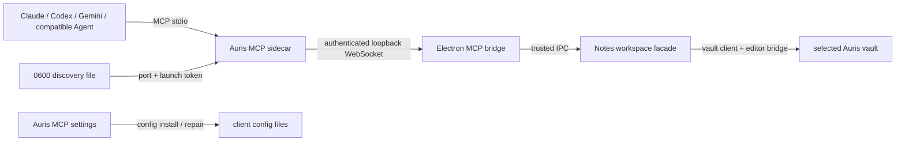

# Auris VMark-Equivalent MCP Design

**Date:** 2026-06-21

## Goal

Make Auris a local-first MCP host that external agents can connect to through
Claude Desktop, Claude Code, Codex CLI, Gemini CLI, or any compatible stdio
client.  The experience matches VMark's collaboration workflow: users can
enable and inspect the service in the app, install client configuration, and
let an agent safely discover, create, open, read, write, save, close, and
switch Auris notes.

## Confirmed scope

- The MCP client may operate on the selected Auris vault, not merely the
  currently focused selection.
- The MCP client may create, open, save, close, and switch note tabs and may
  read or write a complete note or the current selection.
- The client may not address arbitrary host paths, operate a terminal, access
  account data, or control unrelated Auris features.
- The setting surface follows the supplied VMark references: service enablement
  and health, launch-at-startup, default-on review versus explicit auto-approve,
  connected-client count, and install/repair/remove actions for four clients.

## Non-goals

- Matching VMark's YAML workflow editor or its `actionlint` integration; Auris
  does not currently provide an equivalent editor domain.  The contract is
  intentionally extensible with a future `workflow` tool without pretending
  the feature exists today.
- Arbitrary filesystem browsing or write access outside the selected Auris
  vault.
- A remote HTTP/Streamable MCP endpoint.
- Sending note contents to Auris servers or a cloud proxy.

## Architecture



The standard stdio sidecar is the only external MCP endpoint.  The Electron
bridge is loopback-only, has a per-launch token, and forwards a versioned,
bounded request allowlist to the Notes renderer.  The renderer remains the
authority for the active vault, tab state, editor source, dirty state, save
state, and mutation review.

## MCP contract

The sidecar registers four composite tools.  Grouping actions avoids a broad,
hard-to-discover tool list while retaining VMark's agent-oriented workflow.

| Tool | Actions | Purpose |
| --- | --- | --- |
| `auris_session` | `get_state` | Discover selected vault, open tabs, focused tab, revisions, dirty state, capabilities, and review mode in one request. |
| `auris_workspace` | `new`, `open`, `save`, `close`, `switch_tab` | Create a note in the vault, open a vault-relative note, flush a tab's pending save, close a tab without silently losing dirty changes, or focus a tab. |
| `auris_document` | `read`, `write` | Read full Markdown or replace it with an optimistic `expected_revision`. |
| `auris_selection` | `get`, `set` | Read or replace the active selection using the editor's native source/WYSIWYG semantics with an optimistic revision. |

All paths in tool arguments are validated vault-relative POSIX paths.  Absolute
paths, `..` traversal, empty paths, directories where a note is required, and
non-Markdown targets are rejected.  The server never returns the host's
absolute vault path.

### Mutation policy

By default, a write or selection replacement creates an in-app pending change
with a concise before/after preview.  It is not committed to the editor or
vault until the user accepts it.  The tool response identifies the pending
change so the agent can describe what it proposed.  Users can enable
`autoApproveEdits` in MCP settings; then the same mutation immediately uses the
existing editor/workbench save path and remains undoable.

For full-document writes and selection replacements, the caller supplies the
revision returned by `read`, `get_state`, or `get`.  A mismatch returns a
structured `STALE` envelope with `current_revision` and never changes content.
The revision is SHA-256 of UTF-8 Markdown source, not a timestamp.

### Error envelope

Domain failures are passed to MCP clients as `isError: true` text content
containing JSON:

```ts
{
  error: "STALE" | "INVALID_PATH" | "INVALID_TAB" | "NOTES_UNAVAILABLE" |
    "READ_ONLY" | "DIRTY" | "PENDING_REVIEW" | "INVALID_ARGUMENT" |
    "INTERNAL",
  message: string,
  current_revision?: string,
}
```

## Settings and installation

The Notes settings page gains an **MCP Integration** section based on the
provided VMark references.  It has:

- master enable switch and launch-at-startup switch;
- auto-approve edits switch, off by default;
- running/disabled/error state, sidecar version, tool count, connected-client
  count, listener label, and a `Test connection` action;
- provider rows for Claude Desktop, Claude Code, Codex CLI, and Gemini CLI;
- install, update/repair, remove, and copy-config actions; and
- a restart notice after a client configuration changes.

Installers update only the designated MCP entry while preserving all other
configuration.  Client configuration points at the packaged sidecar when
available, otherwise the development sidecar using an absolute Node command.
Writes are atomic and surface permission/parse errors in the UI.

## Security and lifecycle

- Electron binds a port allocated by the OS on `127.0.0.1`; it never listens
  on a LAN interface.
- A random token is written only to a `0600`, atomically renamed discovery
  file after listening starts.  It is never a URL query parameter, renderer
  API value, log value, MCP response, or client configuration value.
- The bridge has payload, request-count, and request-time limits and removes
  pending requests for success, rejection, timeout, socket closure, and app
  shutdown.
- Service disablement closes client sockets, removes discovery state owned by
  that launch, and makes subsequent calls fail closed.
- External state changes and user edits always win over stale agent writes.

## Data flow

1. Auris starts the bridge when MCP is enabled and publishes discovery only
   after the bridge listens.
2. An external client starts the sidecar from its configuration; the sidecar
   reads discovery, authenticates, and advertises the four MCP tools over
   stdio.
3. `auris_session.get_state` gives the agent current tab and capability
   context.
4. Read operations query the workbench's live document model.  Workspace
   operations use the established vault client and workspace store, never a
   direct sidecar filesystem call.
5. A mutation checks its revision immediately before either creating a pending
   review or applying through the editor/workbench state path.
6. Acceptance, rejection, and auto-approval update status and make the next
   session state observable to clients.

## Acceptance criteria

- A real MCP client discovers all four Auris tools over stdio without protocol
  noise on stdout.
- Claude Desktop, Claude Code, Codex CLI, and Gemini CLI configurations can be
  installed, repaired after a path move, and removed without overwriting other
  entries.
- An agent can discover a vault, create/open/save/close/switch notes, and
  read/write a document and selection within that vault.
- Any traversal or absolute-path attempt is rejected; no tool accesses a file
  outside the selected vault.
- Default mutation behavior shows an in-app review and does not alter the
  document until accepted; auto-approve makes the same mutation immediately
  visible and undoable.
- Stale revisions, unavailable notes, dirty close requests, malformed input,
  disabled service, malformed discovery, and unauthenticated loopback requests
  fail predictably and do not mutate data.
- The Settings experience exposes service health and the four installation
  targets shown in the supplied VMark reference.
- Unit, component, bridge integration, stdio integration, lint, typecheck,
  and relevant desktop smoke tests provide evidence for the above behavior.
