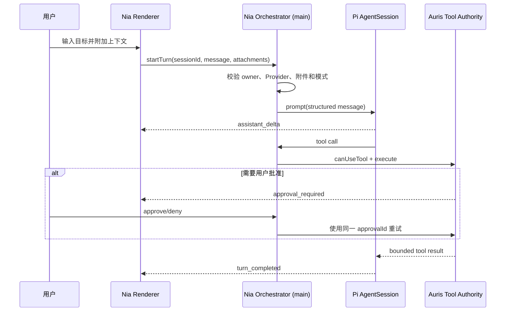
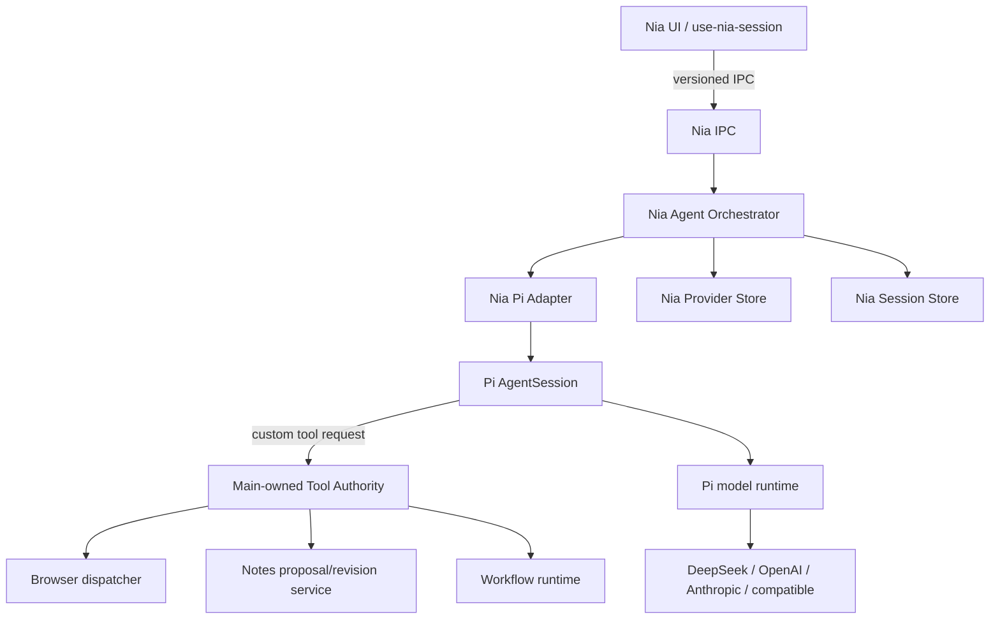

# Nia Pi Agent Core 设计规格

**日期：** 2026-08-16

**状态：** Draft

**对应实施计划：** `docs/superpowers/plans/2026-08-16-nia-pi-agent-core.md`

## 1. 摘要

本项目把 Nia 的 Agent 模式迁移到 Pi Agent Runtime。Pi 负责会话、多轮推理、工具循环、上下文压缩、重试和中断；Auris 继续负责模型凭据、浏览器与笔记权限、工作流、持久化策略和 UI。

这不是把 Proma 的代码复制进 Auris。实现只使用 MIT 许可的 Pi 公共 API，并独立编写 Nia 适配层。现有 Nia 单轮调用保留为 Chat/兼容路径，直到 Agent 路径通过全部安全与打包验收。

## 2. 联系人

| 角色 | 负责人 | 职责 |
| --- | --- | --- |
| 产品负责人 | Auris maintainer | 决定范围、默认模式和发布门槛 |
| Agent Runtime | 待指派 | Pi 适配、会话、事件和模型协议 |
| Electron 安全 | 待指派 | 主进程权限、utility process 和凭据边界 |
| Notes/Workflow | 待指派 | 笔记提案、工作流工具和审核体验 |
| QA | 待指派 | 契约、对抗、打包和桌面 smoke 测试 |

## 3. 背景

### 3.1 当前状态

Nia 已经具备可复用定义、Provider 配置、流式响应、取消、所有者绑定、显式上下文卡片、本地记忆、浏览器权限链和工作流运行时。但 Agent 能力仍然分散：

- 普通 REST/CLI 请求是一次性 prompt 调用。
- 浏览器自动化在 `nia-provider-runtime.cjs` 内使用一套专用、最多 8 轮的工具循环。
- `nia-tool-registry.ts` 目前只描述 UI 可用性，不是可执行的主进程工具注册表。
- Renderer 把当前输入、上下文卡片和已确认记忆拼成一个字符串；它没有提交结构化的会话消息。
- 会话历史是 Renderer 侧可选 localStorage 记录，不能恢复完整 Agent 状态。
- OpenAI-compatible 流式解析没有把 DeepSeek 的 reasoning/tool-call continuation 作为完整会话状态管理。

结果是浏览器能“有限地行动”，但笔记、工作流、长期会话、压缩和中途追加指令还没有一个共同内核。

### 3.2 为什么现在做

Pi 已提供可嵌入的 AgentSession、统一多模型协议、工具调用、会话状态、压缩、steering/follow-up 和事件流。Proma 已验证“Pi 做内核、Electron 产品做宿主”的桌面架构可行：

- [Proma Agent Runtime 说明](https://github.com/proma-ai/Proma#agent-运行时与模型渠道)
- [Proma Pi Adapter](https://github.com/proma-ai/Proma/blob/main/apps/electron/src/main/lib/adapters/pi-agent-adapter.ts)
- [Pi Agent Harness](https://github.com/earendil-works/pi)

Pi 本身采用 MIT 许可证；Proma 的产品封装采用 AGPL-3.0。Auris 可以使用 Pi，但不能直接移植 Proma 的 AGPL 胶水代码，除非另行满足许可证要求。

### 3.3 已确认约束

- Electron main 始终是权限权威。
- Renderer 不能生成工具授权、浏览器 lease、approval、可信页面引用或凭据。
- 页面文本、笔记内容、工作流文件和模型输出全部是不可信输入。
- 笔记写入默认只生成提案，必须经过 revision 检查和用户审核。
- 浏览器操作继续复用现有 dispatcher、owner、lease、grant 和单次 approval 链。
- 未显式附加的笔记、页面、选区和工作流不能自动进入 Agent 上下文。
- 未开启本地历史时，不得因为引入 Pi 而默认持久化完整对话。
- 第一版不赋予 Pi 内置 Shell、任意文件系统或网络下载工具。

## 4. 目标

### 4.1 产品目标

让用户可以在同一段 Nia 会话中表达一个多步骤目标，由 Agent 安全地读取显式上下文、调用 Auris 工具、处理工具结果、继续推理，并交付最终结果。模型可以替换，Auris 的权限规则不随模型变化。

### 4.2 工程目标

- 用 Pi AgentSession 取代 Nia 自写的浏览器专用工具循环。
- 建立稳定的 `Nia Orchestrator -> Pi Adapter -> Tool Authority` 边界。
- 让 DeepSeek、OpenAI、Anthropic 和兼容端点共享同一 Agent 生命周期。
- 把会话、turn、tool call、compaction 和 cancellation 建模为明确状态，而不是 UI 字符串约定。
- 保留现有 Chat/CLI 能力作为兼容路径，降低一次迁移风险。

### 4.3 非目标

- 不复制 Proma 的 UI、自动化、协作子 Agent 或完整工具集。
- 不在首版提供任意 Shell、Git 或工作区外文件访问。
- 不让 CLI Provider 获得 Auris 内部工具权限。固定 CLI 适配器继续作为单轮兼容执行器。
- 不在首版实现多 Agent 协作、session fork/rewind、远程机器人或 MCP Server 动态安装。
- 不改变现有浏览器 authority、笔记 revision 或工作流审批规则。
- 不把模型的 reasoning 原文默认展示或长期保存。

### 4.4 Key Results

1. 在发布候选版中，三个基准任务——“读页面后总结”“读笔记后提出修改”“运行已审核工作流并解释结果”——连续 30 次运行的协议完成率不低于 95%。
2. 所有跨 owner、伪造 approval、陈旧 revision、未附加上下文和取消后晚到结果测试 100% 失败关闭，且没有越权副作用。
3. 用户取消后 2 秒内进入终态；取消后的 delta、tool result 和 completion 不再进入 Renderer。
4. 开启本地历史时，应用重启后能恢复同一 Pi session 并继续下一 turn；关闭历史时，重启后不存在可恢复的消息正文。
5. macOS 和 Windows 打包产物均通过 Pi 启动、一次模型调用、一次模拟工具调用和会话恢复 smoke 测试。
6. Agent 路径上线后，现有 Nia Provider、Browser、Workflow 和 Notes 相关测试无回归。

## 5. 用户问题与场景

### 5.1 目标用户

市场按任务定义，而不是按人口属性定义：

- 需要在 Auris 内完成“理解 -> 行动 -> 检查”闭环的用户。
- 希望使用 DeepSeek/OpenAI/Anthropic，但不想为每个模型学习不同 Agent 行为的用户。
- 重视本地数据、写入审核和可取消操作的笔记用户。
- 需要让 Agent 操作受管浏览器，而不愿交出任意桌面控制权的用户。

### 5.2 核心 Job Stories

- 当我在浏览器中研究资料时，我想让 Nia 连续打开、阅读和比较页面，从而得到带来源的结论。
- 当我选中一篇笔记时，我想让 Nia 先阅读再提出修改，从而保留最终写入决定权。
- 当一个任务需要已有工作流时，我想让 Nia 调用它并根据结果继续工作，而不是让我手动复制每一步输出。
- 当上下文过长时，我想让任务继续进行，而不是突然丢失目标或突破权限范围。
- 当 Agent 方向不对时，我想立即停止或追加指令，并确保旧操作不会在后台继续。

### 5.3 场景限制

- Agent 只看见用户显式附加的上下文，以及由工具在授权范围内返回的结果。
- 用户可能中途导航、修改笔记、收回浏览器控制或关闭窗口；Agent 必须把这些当成正常并发事件。
- Provider 可能不完整支持流式、tool calls、reasoning 或上下文窗口；能力必须在启动前解析并明确降级。

## 6. 价值主张

| 用户需要 | 当前痛点 | 新方案价值 |
| --- | --- | --- |
| 多步骤完成任务 | 浏览器循环与普通聊天分离 | 一个 Pi 会话统一推理和工具循环 |
| 更换模型 | 每个协议可能需要独立逻辑 | Provider 变化不改变 Nia 工具和权限 |
| 安全行动 | 模型容易把上下文当授权 | 主进程每次工具调用重新检查权限 |
| 长任务 | prompt 越来越长，难恢复 | Pi session、压缩和明确的 turn 状态 |
| 可观察与可停止 | UI 只看到文本和简单工具状态 | 标准事件、进度、终态和晚到结果隔离 |
| 本地隐私 | 新 runtime 可能隐式保存内容 | 持久化继续由用户的历史开关控制 |

Nia 相对通用桌面 Agent 的差异不是工具数量，而是“显式附加、主进程权威、笔记提案审核、浏览器细粒度授权”四个边界。

## 7. 解决方案

### 7.1 用户体验

#### 模式

- **Chat：** 单轮/轻量对话。保留现有 Provider Runtime；不执行 Auris Agent 工具。
- **Agent：** 使用 Pi Agent Core。可以进行多轮工具调用、压缩、取消和后续指令。
- 迁移期默认值保持现状。Agent 达到发布门槛后，再单独决定是否成为默认模式。

#### 基本流程



#### UI 必须显示

- 当前 Provider、模型和 Chat/Agent 模式。
- 当前 turn 的状态：思考/生成、等待工具、等待批准、压缩、完成、失败、取消。
- 工具名称、动作、完成状态和经过裁剪的安全摘要。
- 需要批准时，显示目标、影响和允许/拒绝；不展示 lease token、secretRef 或内部路径。
- 用户可以停止当前 turn。后续版本增加“立即纠正”与“完成后继续”输入。

### 7.2 总体架构



### 7.3 模块职责

#### Nia Agent Orchestrator

- 验证 Renderer、owner、session 和 run 关系。
- 解析 Provider/模型能力和 Agent 可用性。
- 把显式附件、定义、已确认记忆和系统规则构造成结构化 turn。
- 创建、恢复、取消和关闭 Pi session。
- 统一映射 Pi 事件为 Nia IPC 事件。
- 调用主进程工具权限服务。
- 根据历史策略决定 session 是否落盘。

Orchestrator 不实现模型循环，不直接操作 DOM、vault 或 workflow AST。

#### Nia Pi Adapter

- 通过 Pi 公共 SDK 创建 AgentSession。
- 第一版关闭 Pi builtin tools，只注册 Auris custom tools。
- 工具调用保持顺序执行，避免并发副作用和 approval 竞争。
- 配置最大 turn、最大预算、重试、上下文窗口和 compaction。
- 提供 `prompt`、`abort`、`steer`、`followUp`、`compact` 和 `dispose` 的稳定窄接口。
- 隔离 Pi 版本差异；上层不得直接依赖 Pi 内部事件对象。

#### Tool Authority

工具分成“描述”和“能力”两部分：Pi 进程只获得名称、说明和 JSON Schema；真正的执行函数保留在 Electron main。

```ts
type NiaAgentTool = Readonly<{
  name: string;
  description: string;
  inputSchema: unknown;
  risk: "low" | "medium" | "high";
  requiredContext: readonly ("browser" | "note" | "workflow" | "reading" | "video")[];
  execute(input: unknown, context: NiaToolExecutionContext): Promise<NiaToolResult>;
}>;
```

首版工具：

| Pi 工具 | Auris 实现 | 权限规则 |
| --- | --- | --- |
| `auris_browser` | 现有 `nia-browser-tools.cjs` + browser dispatcher | 每次重新检查 target/lease/grant/approval；禁止 `execute_js` |
| `auris_notes` | Notes live workbench/MCP contract | 只读显式附加笔记；写入仅生成 revision-bound proposal |
| `auris_workflow` | 现有 workflow facade/runtime | 只运行已审核 workflow；effectful step 继续使用原审批链 |

工具结果必须有大小上限、稳定错误码和可供模型理解的文本投影。模型看不到凭据、绝对 vault 路径、owner id、lease token、approval payload hash 或内部 stack。

#### Provider Adapter

- 复用 `nia-provider-store.cjs` 的配置、Keychain 引用和 session key 生命周期。
- 将已启用 REST 渠道动态映射为 Pi Model；模型 ID 不作为代码分支。
- 首版支持 Anthropic Messages、OpenAI Chat/Responses 以及验证过的兼容端点。
- DeepSeek thinking/tool-call 模式必须保留协议要求的 reasoning continuation；如果端点不兼容，则在启动前标记 Agent 不可用，而不是静默退回错误工具循环。
- Provider 重试只能重试无副作用的传输阶段。已经执行过工具后，不自动重放原始 prompt。
- CLI Provider 保留在 Chat 兼容路径，不获得 Auris custom tools。

### 7.4 会话与运行状态

`sessionId` 表示可继续的对话；`runId` 表示一次 turn。两者都由 main 生成并绑定 owner。

```ts
type NiaAgentEvent = Readonly<{
  version: 2;
  sequence: number;
  sessionId: string;
  runId: string;
  type:
    | "session_created"
    | "turn_started"
    | "assistant_delta"
    | "tool_started"
    | "tool_progress"
    | "approval_required"
    | "tool_completed"
    | "compaction_started"
    | "compaction_completed"
    | "turn_completed"
    | "failed"
    | "cancelled";
  payload: Readonly<Record<string, unknown>>;
}>;
```

规则：

- 每个 session 同时最多一个 active turn。
- 事件有单调递增 sequence，Renderer 可以丢弃重复或倒序事件。
- terminal event 只能出现一次。
- cancel 会 abort 当前模型调用、在途工具和等待批准，并使后续事件失效。
- Renderer 导航或销毁时，非后台 session 立即取消。
- `getSession` 返回红acted snapshot，不返回消息正文以外的内部 Pi artifact。

### 7.5 上下文和记忆

- Renderer 不再把所有内容拼成一个 `wirePrompt`。
- startTurn 传递一条用户消息和一组有类型、来源、revision、大小限制的附件引用/快照。
- main 再次验证附件是否属于当前 owner 和当前页面/笔记状态。
- 已确认记忆只是背景信息，不是行动授权；每个 turn 都在系统上下文中重申这条规则。
- compaction 摘要不得把历史附件提升为当前授权。需要行动时仍要重新满足当前 tool policy。
- 页面和工具返回中的指令视为不可信内容，不能覆盖系统权限规则。

### 7.6 持久化和隐私

- **历史关闭：** 使用临时 Pi session；窗口关闭或应用退出后删除会话正文和 tool result。可以保留不含内容的本地故障计数。
- **历史开启：** Pi session artifact 存储在 Auris app data 的 Nia 专用目录；索引使用原子写入，只保存 opaque sessionId、Provider/模型、时间和展示标题。
- 不在 Renderer localStorage 和 Pi artifact 中双写两份完整正文。迁移后 Renderer 历史只保存显示索引或逐步淘汰。
- reasoning 默认只在运行期间用于协议 continuation；不作为用户历史正文持久化。
- 删除 session 必须删除索引和对应 artifact，并在测试中验证不会遗留孤儿文件。

### 7.7 进程隔离

分两阶段实施：

1. **兼容验证阶段：** Pi 运行在 Electron main 内，减少 CJS/ESM、打包和 capability RPC 的同时变量；所有既有安全检查仍然有效。
2. **隔离阶段：** 每个 active session 使用一个 Electron utility process。只把可序列化的模型配置、消息和工具描述发送给子进程；工具执行通过 capability RPC 回到 main。

utility process 不拥有浏览器 lease、vault 任意路径访问、Keychain API 或 Renderer IPC。Provider key 只在运行内存中短暂存在；禁止写入 argv、环境变量、日志或持久化 artifact。若实测 Pi transport 无法避免把 key 交给 utility process，则在安全评审中二选一：让模型传输留在 main，或接受一个受限、随 session 销毁的 secret capability。

### 7.8 依赖与打包

- 精确锁定 `@earendil-works/pi-agent-core`、`@earendil-works/pi-ai`、`@earendil-works/pi-coding-agent` 的同一已验证版本，不使用 `^`。
- 不默认采用 Proma 的私有 patch；确有需要时先写最小复现和上游 issue，再由 Auris 单独评审补丁。
- Pi runtime 进入 `scripts/assemble-electron-runtime-deps.cjs` 的 audited roots 和闭包清单。
- 验证 CJS 动态导入、asar/unpack、native addon、macOS 签名以及 Windows 打包路径。
- 依赖升级必须运行 Provider、tool loop、session resume、runtime dependency inventory 和 packaged smoke 套件。

### 7.9 安全不变量

1. 模型建议动作，main 决定动作是否允许。
2. 工具描述不是工具能力；没有 main capability 就不能执行。
3. 上下文可见不等于写入授权。
4. approval 必须是一次性、短时、owner/target/payload 绑定。
5. navigation、revision、owner、control epoch 或 payload 变化会使旧授权失效。
6. retry 不得重复已经成功的副作用。
7. compaction、resume 和 follow-up 不得扩大 session 权限。
8. 取消是终态；晚到结果不得改变 UI、会话或外部状态。
9. 错误和日志不得包含 key、secretRef、lease、approval、绝对 vault 路径或完整敏感页面内容。
10. Pi builtin Shell/File 工具默认关闭；未来启用必须另写 threat model 和规格。

### 7.10 可观测性

本地诊断记录以下不含内容的数据：session/run id 哈希、Provider 类型、模型、turn 数、工具名、耗时、token/成本（若 Provider 返回）、重试次数、compaction、终态和错误码。

诊断默认不记录 prompt、assistant 正文、reasoning、工具原始输入输出、页面文本、笔记文本或凭据。任何未来上传都必须另行 opt-in。

### 7.11 假设与待验证项

| 假设 | 验证方式 | 失败后的处理 |
| --- | --- | --- |
| Pi 当前版本可在 Electron 41 + Node/CJS 主进程稳定加载 | 打包 spike + macOS/Windows smoke | 建独立 ESM utility entry，不在 main 直接加载 |
| Pi custom tools 可完全关闭 builtin tools | 契约测试枚举实际工具列表 | 在 adapter 外增加 allowlist guard，未知工具 fail closed |
| DeepSeek 兼容端点能完成 reasoning + tool continuation | 官方/真实端点集成测试 | 该 Provider 标记 Agent unavailable，仅保留 Chat |
| Pi session artifact 可服从 Nia 历史开关 | 临时/持久化文件审计 | 包装或替换 SessionManager 存储适配器 |
| 顺序工具执行足够覆盖首版场景 | 三类基准任务 | 未来只对明确只读工具开放受控并行 |
| 三个复合工具对模型足够清晰 | eval 记录工具选择错误率 | 调整 schema/描述；不先扩大权限 |

## 8. 发布

### 8.1 分期

| 阶段 | 相对周期 | 交付内容 | 发布门槛 |
| --- | --- | --- | --- |
| P0 兼容 Spike | 约 1 周 | Pi 加载、一个 mock Provider、一个只读工具、流式/取消、打包验证 | 决定版本、加载方式和进程方案 |
| P1 Agent MVP | 约 2–3 周 | session/turn、Provider 映射、浏览器工具、Notes read/proposal、统一事件 | 核心契约和安全测试通过；功能默认关闭 |
| P2 长任务 | 约 1–2 周 | 持久化、resume、compaction、steer/follow-up、DeepSeek reasoning | 隐私和恢复矩阵通过 |
| P3 隔离与发布 | 约 1–2 周 | utility process、capability RPC、打包 smoke、UI polish | macOS/Windows 与对抗测试全部通过 |
| 后续 | 未承诺 | MCP 动态工具、子 Agent、fork/rewind、受控并行工具 | 每项独立规格与安全评审 |

### 8.2 Feature Flag 与回退

- 增加 `niaPiAgentRuntime` capability，初始为 false。
- Flag 关闭时，所有现有 Chat 和 Nia browser-tool 行为保持可用。
- Flag 开启但 Provider 不兼容时，UI 明确说明原因，不静默切换到权限不同的 CLI Agent。
- 发布期保留旧 browser loop 一版作为回退；Pi 浏览器路径稳定后删除旧循环，避免永久维护两套 Agent 行为。

### 8.3 最终验收

- Pi 是 Agent 模式唯一的模型/工具循环实现。
- Auris 是唯一权限权威；Pi 和 Renderer 都不能绕过 main。
- 浏览器、笔记和工作流使用原有安全服务，没有平行实现。
- Chat、CLI、Provider 配置、Keychain 和历史开关无回归。
- 依赖许可证、版本、补丁和打包闭包有可审计记录。
- 文档、单元测试、集成测试、桌面 smoke 和回退说明齐全。
