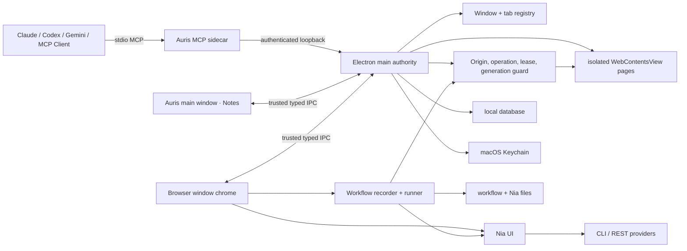

# Auris VMark Browser, Nia, Workflow, and Multi-Window Design

- **Date:** 2026-07-17
- **Status:** Approved by user; ready for implementation planning
- **Product:** `auris/`
- **Platform:** macOS first
- **Upstream baseline:** `xiaolai/vmark` `7c409688dc510d87183bdc46308e1ee645c2579f` (`v0.9.1`, 2026-07-17)
- **Porting strategy:** behavior- and contract-compatible vertical port

## 1. Decision summary

Auris will port VMark's browser automation, workflow, AI-assistance, and
multi-window capabilities into the existing `auris/` Electron application.
The port will preserve VMark's public behavior, closed operation vocabulary,
approval semantics, session safety, workflow behavior, and relevant tests
where the source architecture permits it.

The following product decisions are final:

1. `auris/` remains the only actively maintained desktop product. No sibling
   desktop application or copied product tree will be created.
2. The first supported platform is macOS.
3. The browser is a separate top-level Electron window, not a pane embedded in
   the Notes window.
4. The implementation uses Electron `BrowserWindow` plus isolated
   `WebContentsView` page surfaces instead of VMark's Tauri/Rust/WKWebView
   native surface.
5. External agents drive the browser through Auris MCP first. Knowcraft is not
   integrated in this scope.
6. VMark's Genie system is ported completely but renamed **Nia** throughout
   Auris. Imports continue to accept the legacy workflow step name `genie`.
7. VMark's AI/human automation lease semantics are made authoritative in the
   Electron main process. This intentionally completes a VMark module that is
   present and tested upstream but marked as not wired into production.
8. Browser behavior and security contracts track VMark. The separate top-level
   browser-window layout is the one deliberate product-shell difference.

## 2. Goal, context, constraints, and completion evidence

### Goal

Give Auris a visible, local-first research browser that external agents can
safely operate through MCP, can produce source-backed drafts in Notes, can run
recorded workflows, and can scale to multiple independently targetable windows.
Also provide VMark-equivalent built-in AI skills under the Auris name **Nia**.

### Context

Auris is an Electron 41, Next.js 16, React 19, TypeScript desktop application.
It already has:

- one primary desktop `BrowserWindow` and a separate PDF print window;
- an authenticated loopback Notes MCP bridge and stdio MCP sidecar;
- grouped MCP tools for session, workspace, document, and selection actions;
- revision-safe Notes writes and a default edit-review flow;
- trusted desktop IPC guards and a narrow desktop permission policy;
- local-first Notes workspace storage, tests, and settings UI.

VMark 0.9.1 supplies the reference behavior for:

- browser page/tab state and browser chrome;
- ARIA snapshots with stable references;
- click, type, scroll, key, navigation, screenshot, query, style, JavaScript,
  console, wait, and session actions;
- origin-bound approvals, one-shot grants, and in-memory standing grants;
- AI sandbox/shared modes and navigation policy;
- browser session handles, crash recovery, and lifecycle state;
- browser workflows, recording, replay, and self-healing proposals;
- AI Genie providers and workflow steps;
- window status and multi-window management.

### Constraints

- Preserve all unrelated and user-authored changes in the currently dirty
  worktree. Do not reset, overwrite, or broadly reformat existing work.
- Do not create another Next.js/Electron/Tauri product directory.
- Browsed pages are untrusted and must never receive Auris's privileged preload
  or Node access.
- Auris-managed secrets must not enter renderer persistence, logs, MCP payloads,
  workflow files, or agent-visible metadata. Page-visible content is untrusted
  and may itself contain sensitive text; explicit reads and screenshots cannot
  promise semantic redaction.
- Bound all external inputs with explicit schemas and limits.
- Preserve Notes revision checks and edit review rather than writing around the
  existing workbench facade.
- Keep implementation files small and cohesive; do not continue expanding
  `electron/main.cjs` into a browser subsystem.
- VMark code is ISC licensed. Copied or modified source must retain the required
  copyright and license notice.

### Done when

The project is complete only when all of the following are demonstrated:

1. A real macOS Auris build can open, close, restore explicitly retained human
   research windows/tabs, and operate separate browser windows with multiple
   isolated page tabs, while AI-owned tabs remain transient.
2. A real MCP client can complete a research loop: open or select a browser
   target, navigate, observe, act with approval, verify, create an evidence
   bundle, and propose a revision-safe Note write.
3. Attempts involving stale navigation generations, wrong tabs, wrong origins,
   lost leases, disallowed destinations, unapproved operations, substituted
   payloads, or forbidden uploads are rejected by the Electron main process.
4. MCP returns only the page data explicitly requested by a bounded read,
   screenshot, query, or console action and marks that data untrusted.
   Auris-managed Keychain values, cookie/localStorage session blobs, URL
   credentials, and Nia API keys never enter MCP responses, logs, audit records,
   or plain-text state. A page can itself display or log sensitive text; such
   page-visible data may appear in an explicit read or screenshot and cannot be
   promised automatic redaction.
5. Nia can run through supported CLI and REST providers, stream output, cancel
   cleanly, apply results through review-aware UI, and execute as a workflow
   step.
6. Browser workflows can be validated, recorded, replayed, cancelled, and
   recover from a changed selector only by proposing a reviewable repair.
7. Multiple browser windows can run concurrently and MCP never silently guesses
   between ambiguous targets.
8. A reproducible upstream comparison report shows the VMark baseline, mapped
   Auris modules, intentionally divergent behavior, and unreviewed upstream
   changes.
9. Relevant unit, component, integration, Electron smoke, and adversarial tests
   pass. Unrun validation and remaining platform risk are reported explicitly.

## 3. Source provenance and update tracking

The initial port is based on VMark commit
`7c409688dc510d87183bdc46308e1ee645c2579f`. The repository is ISC licensed:
use, copying, modification, and distribution are permitted when the VMark
copyright and permission notice remain present.

Auris will keep a machine-readable port manifest containing, for each imported
or behavior-mapped module:

- upstream repository and commit;
- upstream path;
- Auris path;
- disposition: `copied`, `adapted`, `rewritten`, or `not-applicable`;
- intentional differences;
- last comparison date;
- relevant Auris tests.

The manifest uses a versioned JSON schema with a repository-level baseline and
an entry array. Every entry has a stable `mappingId`, `upstreamPaths[]`,
`aurisPaths[]`, `disposition`, `intentionalDifferences`,
`lastComparedCommit`, and `tests[]`. Mapping IDs are unique; path arrays permit
one-to-many, many-to-one, and many-to-many ports without inventing duplicate
records.

The repository exposes `scripts/vmark-sync-report.cjs` through one deterministic
read-only command, `npm run vmark:diff -- --upstream <commit>`, which:

1. fetches or refreshes a cache outside the Auris source tree;
2. resolves the upstream commit explicitly supplied by the caller, or reports
   the resolved `origin/main` commit in the output;
3. validates the manifest schema and path uniqueness;
4. detects changed, added, deleted, and renamed upstream paths;
5. reports missing Auris targets and stale `lastComparedCommit` entries;
6. writes canonical JSON to `docs/vmark-sync/latest.json` and a human-readable
   report to `docs/vmark-sync/latest.md`, with stable key ordering and no
   timestamps inside the canonical comparison payload.

The command must never overwrite Auris source automatically. During
implementation, each vertical phase begins by refreshing the report and
consciously accepting or deferring upstream changes. Only after the manual
process is stable may it be promoted to a recurring automation under the
workspace's automation rules.

## 4. System architecture

### 4.1 Trust boundaries

| Boundary | Trust | Responsibility |
|---|---|---|
| Electron main process | Authoritative | Windows, tabs, surfaces, permissions, leases, sessions, execution, audit |
| Browser chrome renderer | Trusted UI, non-authoritative | Tabs, omnibox, bookmarks, approval dialogs, state display |
| Main Auris renderer | Trusted UI, non-authoritative | Notes and global window status UI |
| Browsed page | Untrusted | Remote page content only; no Node or Auris preload |
| MCP sidecar | Narrow trusted adapter | Schemas, stdio cleanliness, authenticated bridge forwarding |
| Nia provider process/API | External and potentially agentic | Bounded input/output, timeout, cancellation; CLI tools may have their own tool authority and are not assumed generation-only |

The renderer may advise that an operation appears approved, but only the main
process may authorize and execute it.

### 4.2 Proposed module boundaries

Implementation stays inside `auris/` and should converge on these cohesive
areas rather than a monolithic `electron/main.cjs` patch:

- `electron/browser/`: registry, surface manager, navigation, permission guard,
  lease, session/keychain adapter, recovery, persistence, audit, and IPC.
- `electron/mcp/` or the existing MCP files: grouped Browser and Workflow MCP
  registration and authenticated forwarding.
- `src/features/browser/`: pure tab projection, URL handling, ARIA/ref scripts,
  reader, approval types, workflow core, and renderer services.
- `src/components/browser-window/`: browser chrome, tabs, omnibox, history,
  bookmarks, approval UI, crash UI, and status indicators.
- `src/features/nia/` and `src/components/nia/`: provider configuration,
  prompts, execution state, streaming response, history, and apply UI.
- `src/features/workflows/` and workflow components: schema, recorder, runner
  presentation, self-heal review, and persistence.
- focused test directories mirroring each boundary.

Exact paths may adapt to existing repository conventions during planning, but
the authority boundaries must not collapse back into one file.

## 5. Window and browser surface model

### 5.1 Top-level windows

The existing Auris main window continues to host Notes, Reading, and the main
application shell. Browser work lives in separate top-level browser windows.

The default user action reuses the most recently active browser window. Users
may explicitly create additional browser windows. The registry supports `N`
browser windows from the first implementation even if the earliest UI exposes
only one reusable window.

Each browser window owns:

- a stable `windowId`;
- trusted browser chrome;
- an ordered list of browser tabs;
- one active `WebContentsView` and zero or more hidden/hibernated views;
- geometry, focus, and crash/recovery state;
- a visible AI/human control indicator.

Each tab owns:

- a stable `tabId` never reused in-process;
- its parent `windowId`;
- a monotonic `navigationGeneration`;
- provisional and committed URL state;
- title, loading, history, and favicon metadata;
- automation mode and policy epoch;
- current control epoch and optional lease owner/token;
- lifecycle state: creating, ready, hibernated, crashed, or closed;
- session/profile identity without exposed credential values.

### 5.2 Automation modes and partitions

The Electron session partition is chosen by automation mode and never inferred
from the current URL:

| Mode | Partition | Read/attachment rule | Restart rule |
|---|---|---|---|
| `Human` | persistent human profile | every AI read/action requires an attachment (`once` or `until-navigation`) in addition to operation authority | explicitly retained human research tabs may restore; attachments never restore |
| `AiSandbox` | shared non-persistent sandbox partition, isolated from human data | reads are allowed only within the sandbox/profile origin policy; actions still follow grants | AI tabs and sandbox state are transient |
| `AiShared` | persistent human profile | every AI destination needs approval unless an in-memory origin+`navigate` standing grant applies | AI-created tabs are transient; human profile data remains owned by the human session |

Named persistent profiles, when delivered, are explicit user-managed contexts.
Opening one requires a one-shot capability bound to the profile name and allowed
origin. Profile capability and cookie support must remain feature-gated until
real macOS capture/replay and isolation tests pass.

Browser history is per window and in memory for the application session, matching
VMark. Bookmarks persist using the exact bookmarked URL. Closing and reopening a
browser window during the same Auris run retains its safe research state. Across
an app restart, only explicitly retained human research tabs and window geometry
may restore; AI-owned tabs, attachments, leases, one-shots, standing grants, and
history never restore.

### 5.3 Page isolation

Page views use a dedicated browser session/partition policy and:

- `nodeIntegration: false`;
- `contextIsolation: true`;
- `sandbox: true` where supported;
- no Auris privileged preload;
- a deny-by-default permission request/check handler;
- a navigation and popup policy owned by the main process;
- bounded, isolated-world scripts for agent observation and action.

The browser chrome never trusts page-provided title, URL, favicon, dialog text,
or console payloads without bounds and escaping.

### 5.4 Browser UX surface policy

Every browser-owned surface has an explicit fail-closed disposition:

| Surface | Auris disposition |
|---|---|
| `alert` / `confirm` | bounded native Auris dialog; navigation/teardown cancels parked callbacks |
| `prompt` | suppressed until a separately reviewed secret-safe implementation exists |
| `window.open` / target `_blank` | blocked in the first live slice; later new-tab support must preserve opener isolation and navigation policy |
| download | never automatic; user chooses destination through a native save dialog; agent receives status only |
| file upload | human native picker only; AI can never choose or inject a path |
| TLS/certificate error | hard deny, no click-through |
| HTTP basic authentication | native human prompt; credentials never exposed to page scripts, MCP, workflow, or logs |
| camera, microphone, geolocation, notifications | deny silently for browsed pages |
| external protocols | deny by default; any future handoff is explicit and human-confirmed |
| find, zoom, context menu | bounded browser-chrome implementations |
| print | unsupported in the first browser slice |
| devtools | debug builds only |
| PDF/media/fullscreen | engine behavior only after the same permission and isolation checks |

This policy is enforced by Electron main/session handlers, not merely represented
by a renderer matrix. Teardown drains pending dialogs, downloads, permission
requests, and authentication prompts so a late response cannot target a reused
tab.

### 5.5 Window status center

The main Auris window exposes a status center that lists:

- each top-level Auris and browser window;
- active and background tabs;
- current URL in redacted display form;
- lifecycle/loading/crash state;
- current lease holder;
- current MCP or workflow activity;
- pending approvals and saved-grant status.

It can focus a window or tab, but cannot bypass the operation guard.

## 6. MCP browser research loop

The existing authenticated stdio sidecar remains the only external MCP entry
point. It adds a grouped `auris_browser` tool and, when workflow delivery begins,
an `auris_workflow` tool. Existing Notes tools remain unchanged unless a schema
extension is separately justified and tested.

Browser authority terminates in the Electron main process. Browser methods are
not forwarded to a renderer for execution. Notes writes continue through the
existing live Notes workbench facade because it owns revision and editor state.
The bridge routes these method families explicitly and rejects all others.

Every authenticated sidecar connection receives a random `connectionId`.
Browser commands and pending approvals are connection-scoped. Workflow and Nia
runs add a stable `runId`; disconnect, cancellation, timeout, or process exit
releases owned leases and cancels pending operations. No browser command waits
inside the current fixed ten-second Notes request path while a user decides.

### 6.1 Browser actions

`auris_browser` supports a strict discriminated action union equivalent to the
VMark browser surface:

- state and lifecycle: `get_state`, `open`, `acquire_control`,
  `release_control`, `close`, `focus`;
- navigation: `navigate`, `wait`, `wait_for`;
- observation: `read`, `screenshot`, `query`, `console`;
- interaction: `act` with click, type, scroll, and key variants;
- power actions: `style`, `execute_js`;
- credentials by reference: `session_save`, `session_load`.

Requests identify `window_id` and `tab_id` when needed. A convenience default is
allowed only when there is one unambiguous active/attached target. Ambiguity
returns a typed error containing safe target metadata; it never selects a tab
silently.

`get_state` is a redacted discovery action and requires no lease. `open` creates
an AI-owned tab for the requesting connection and returns `window_id`, `tab_id`,
`navigation_generation`, `control_epoch`, and a new opaque `lease_token`.
`acquire_control` targets an existing eligible tab and, after attachment or
other required approval, returns the same control envelope.
`release_control` requires the current token, cancels the owner's work, rotates
the control epoch, and is idempotent for an already released owner.

Every page-observation, navigation, interaction, session, close, or workflow
execution command envelope binds:

- `windowId`;
- `tabId`;
- `navigationGeneration`;
- `controlEpoch`;
- owner kind (`mcp`, `workflow`, or `nia`) plus connection/run identifier;
- an unguessable, short-lived lease token issued by the main process;
- closed-set operation token;
- structured target descriptor where applicable;
- exact payload hash for payload-bound operations.

`focus` may operate without a lease only as an explicit user-interface request;
it grants no page read or action authority. Lease tokens are returned only to
their owning connection/run, never persisted or logged, and are rejected after
release, disconnect, epoch change, navigation invalidation, tab close, or
window close.

`navigationGeneration` changes when the document/view identity changes.
`controlEpoch` changes when control ownership or policy authority changes. They
are deliberately separate: a human reclaim invalidates control without
pretending the page navigated, while a navigation invalidates both page-bound
references and any in-flight control capability.

### 6.2 Approval and retry protocol

Approval is an asynchronous two-call protocol, not a long-held MCP request:

1. An unapproved command returns `APPROVAL_REQUIRED` promptly with an opaque
   `approval_id` and a safe descriptor of origin, operation, and target.
2. Electron main registers the pending approval in memory, bound to connection,
   owner/run, window, tab, generation, control epoch, origin, operation, target,
   and payload hash. The browser chrome renders it.
3. Deny, expiry, navigation, control loss, window/tab close, policy change, or
   connection close resolves the approval as denied and consumes no authority.
4. Approve creates the exact one-shot or in-memory standing grant selected by
   the user.
5. The same owner retries the same command with `approval_id`. Main atomically
   validates and consumes the pending approval and, when applicable, the
   one-shot before executing. A standing grant remains active until explicit
   revocation or process exit; it is checked, not consumed.

Pending approvals are bounded in count and lifetime. Browser action timeouts are
defined per action. The sidecar timeout must exceed the action timeout by a small
transport margin, but approval time is never included because the first call has
already returned. A lost transport cancels in-flight work and a late result is
discarded.

### 6.3 Research sequence

1. Discover or explicitly bind a browser window and tab.
2. Open or navigate, checking destination and origin policy.
3. Observe using an ARIA snapshot with stable references, a clean page reader,
   screenshot, query, or bounded console view.
4. Request and perform an approved action.
5. Verify with `wait_for`, a new snapshot, screenshot, or console observation.
6. Assemble an evidence bundle.
7. Propose a revision-safe Note write through `auris_document`; preserve the
   existing Notes review and stale-revision behavior.

### 6.4 Evidence bundle

A research result may contain:

- redacted final URL, page title, origin, and access time;
- clean Markdown or bounded excerpts;
- stable element references valid only for their generation;
- optional screenshot references;
- action and approval trace without secret input values;
- source-to-draft citation mapping.

Evidence records are provenance aids, not permanent authorization and not proof
that a dynamic page remains unchanged.

## 7. Authorization and automation control

### 7.1 Closed operation vocabulary

The main process accepts only this closed set, mirrored from VMark:

`read`, `attach`, `click`, `type`, `scroll`, `key`, `style`, `navigate`,
`publish`, `upload`, `eval`, and `session`.

Unknown, misspelled, differently cased, or whitespace-modified operation names
are rejected at the schema boundary and again at the authority boundary.

### 7.2 Operation policy

| Class | Operations | Policy |
|---|---|---|
| Human only | `upload` | AI may never execute autonomously, regardless of any grant |
| Never grantable | `eval`, `session` | Fresh, per-call approval every time |
| Payload-bound | `style`, `eval`, `session` | One-shot binds exact payload or session action/handle hash |
| Origin/operation grantable | click, type, scroll, key, style, navigate, publish | Deny, allow once, or in-memory standing origin + operation grant as applicable |
| Read class | read and screenshot-as-read | Only for an allowed/attached committed origin and valid mode |

Standing grants bind only canonical committed origin plus operation and remain
in memory for the current Auris run. They never survive restart. They still do
not satisfy human-tab attachment, lease, policy-epoch, or freshness checks.

One-shot approvals bind connection/owner, window, tab, navigation generation,
control epoch, origin, operation, structured target, and payload hash when the
operation is payload-bound. Denied operations consume neither a one-shot
approval nor a human attachment. Settings lists current-run standing grants and
can revoke them immediately.

### 7.3 Authoritative checks

Before executing a page command, the main process must confirm:

1. browser automation policy is enabled;
2. window and tab exist and are related;
3. command generation is current;
4. a committed top-level URL exists;
5. the operation token is known;
6. the tab's policy epoch is current;
7. the committed origin—not a caller-supplied URL—permits the operation;
8. attachment, one-shot, in-memory standing grant, and lease requirements are satisfied;
9. payload/target binding matches the approval;
10. the command remains fresh after any long-running capture or evaluation.

### 7.4 AI navigation policy

AI navigation accepts only trimmed HTTP(S) URLs and rejects:

- URLs containing backslashes or credentials;
- malformed or special schemes;
- loopback unless explicitly enabled for development;
- private, link-local, multicast, shared, documentation, and special-use IPs;
- metadata hostnames and cloud instance metadata destinations.

Human omnibox navigation is a separate policy and may allow local development
destinations without granting them to AI automation.

### 7.5 AI/human lease

The main process owns one automation lease per tab. A lease has an owner kind,
owner id (`connectionId` or `runId`), random capability token, and control epoch;
it is not represented only as the words `ai` or `human`.

- Human input immediately and unconditionally reclaims the tab.
- Reclaim, navigation, release, policy change, tab close, or window close
  cancels the in-flight AI step and invalidates its generation.
- An automation owner may reacquire its own valid lease but cannot inherit or
  reuse another MCP connection's or workflow run's lease. AI automation may
  acquire a free tab but never a human-held tab.
- A late result is discarded after lease loss or generation change.
- UI state mirrors the main-process lease but cannot create authority.

This is an intentional security completion over the VMark baseline: VMark's
lease store currently describes itself as not wired into production.

## 8. Persistence, credentials, recovery, and privacy

### 8.1 Storage allocation

| Store | Data |
|---|---|
| Existing local database/runtime state | window geometry, explicitly retained human tab metadata, bookmarks, workflow runs, bounded audit metadata |
| macOS Keychain | saved cookie/localStorage state and explicitly remembered Nia API keys; never standing browser grants |
| Filesystem | Nia prompt definitions, YAML workflows, source manifest, ISC notices, generated comparison reports |
| Memory only | history, standing grants, one-shot approvals, attachments, leases, default-ephemeral Nia API keys, in-flight payloads, cancellation callbacks, transient page snapshots |

MCP and agents receive opaque session handles plus value-free summaries, never
cookie or localStorage values.

### 8.2 Session save and load

- Save binds the state to the committed origin.
- Handles are bounded to a safe token grammar.
- Load is `session`, always per-call approved and payload-bound.
- Loading into a different origin is refused.
- HttpOnly cookies are never downgraded to script-readable cookies during a
  restore; unsupported safe restoration must skip or refuse them.
- Logs and responses include counts only, not names or values.
- Cookie capture/replay and named persistent profiles remain capability-gated
  until live macOS tests prove domain scoping, teardown, Secure/SameSite
  preservation, HttpOnly fail-safe behavior, and isolation. Before that gate
  passes, the UI and MCP capability response must report the narrower supported
  state honestly rather than claim cookie-complete login restoration.

### 8.3 Crash and lifecycle recovery

- A page process crash affects only its tab/window surface.
- The first three consecutive crashes may auto-reload.
- The next crash enters manual-reload-only state.
- A successful load resets the crash streak.
- Closing a browser window releases live views and retains safe in-process state
  so the same run can reopen it.
- App restart restores geometry, bookmarks, and only explicitly retained human
  tabs. AI tabs, history, attachments, grants, leases, approvals, and credential
  injection do not restore automatically.
- Background views may hibernate under an explicit LRU/memory policy while tab
  identity and restorable state remain stable.

### 8.4 Redaction and audit

Audit records may contain timestamp, redacted origin, operation, target class,
decision, grant kind, window/tab identifiers, workflow/run identifier, duration,
and typed outcome. They must not contain query strings, URL credentials, cookie
data, localStorage values, API keys, arbitrary typed text, raw page HTML, or raw
JavaScript/CSS payloads.

## 9. Nia design

Nia is Auris's name for the VMark-equivalent built-in AI skill system. It is not
Knowcraft and is not positioned as a general autonomous agent.

### 9.1 Capabilities

Nia includes:

- prompt/skill definitions with scope and optional model overrides;
- selection, document, and workflow-step contexts;
- CLI provider detection and execution for supported local CLIs;
- REST providers for Anthropic, OpenAI, OpenAI-compatible services, Google AI,
  and Ollama-compatible endpoints;
- streaming output, typed errors, timeout, cancellation, and retry;
- provider switching and safe model discovery/testing;
- response preview with apply, replace, insert, copy, and discard actions;
- bounded prompt history and per-run status;
- workflow execution as a `nia` step.

Only one default provider is active at a time; a Nia definition may override the
model when the selected provider supports it.

### 9.2 Secret handling

- CLI providers use their own existing authentication.
- REST keys are memory-only by default, matching VMark. A separate explicit
  "remember on this Mac" choice may store a key in Keychain; it is never written
  to localStorage, settings JSON, prompt definitions, or workflow files.
- Requests go directly from the local app to the selected provider.
- Provider logs redact prompts and credentials by default.
- Subprocesses and HTTP requests have timeouts and cancellation.
- Unexpected REST response shapes produce typed errors rather than hanging UI.

CLI provider adapters are a separate execution trust surface because Claude,
Codex, or Gemini CLIs may be configured to call tools rather than only generate
text. Each adapter must use a fixed executable and audited argv, `shell: false`,
stdin for prompt input, a dedicated non-workspace working directory, a minimal
environment allowlist, and no user-supplied raw flags. Auris selects a documented
non-agentic/generation-only mode when the CLI offers one. If a provider cannot
disable tool execution reliably, Nia marks it agentic, explains the risk before
enablement, and requires explicit user acceptance or leaves it unavailable.
Provider output and tool-like text are always treated as untrusted data.

### 9.3 Genie compatibility

Auris user-facing text, source namespaces, new file names, and new workflow
output use `Nia`/`nia`.

The compatibility layer covers the actual VMark formats:

- Nia Markdown definitions use canonical frontmatter `nia: v1`; imports accept
  legacy `genie: v1` and retain source provenance.
- Legacy VMark v0 Markdown Genies that have no `genie` version marker are
  accepted through an explicit v0 parser/migrator. Absence of a marker is not
  silently treated as canonical Nia v1; migration diagnostics identify defaults
  or fields that changed.
- Nia YAML workflow steps use canonical `uses: nia/<name>`; imports accept
  legacy `uses: genie/<name>` and resolve the same definition.
- Built-in definition lookup, install/uninstall, collision handling, parser
  diagnostics, workflow graph labels, export, and tests all understand the
  canonical name plus the legacy alias.
- Auris exports only `nia: v1` and `uses: nia/<name>`.

The port manifest records `VMark Genie -> Auris Nia` for source provenance. The
wire and file migration never relies on a nonexistent `type: genie` field.

## 10. Workflow design

The VMark baseline contains two distinct workflow families. Auris preserves the
distinction instead of forcing them into one misleading schema:

1. **Nia workflows** are YAML pipelines with `uses: nia/<name>` and
   `action/<name>` steps, dependencies, conditions, templating, approvals,
   limits, and typed outputs. This ports VMark's wired Genie workflow engine.
2. **Browser workflows** are Markdown files with `site`, `inputs`, and `trigger`
   frontmatter plus typed `api`, `action`, `goal`, `confirm`, and `extract`
   steps. VMark currently contains parser, runner, recorder, and self-heal cores
   that explicitly describe parts of themselves as not wired.

Wiring browser workflows is therefore the second intentional upstream
completion in this design, after the main-process lease. The product and
capability response must distinguish a pure/experimental implementation from a
runtime-verified one.

### 10.1 Lifecycle

1. Select the workflow family from file form and parse with its own schema.
2. Mark untrusted/imported workflows and require review before first execution.
3. Resolve variables without arbitrary host environment access.
4. Execute one bounded step at a time.
5. Route every browser side effect through the same authoritative guard used by
   MCP; workflows do not get a privileged bypass.
6. Emit progress, approval, result, cancellation, and error events.
7. Persist safe run metadata and reviewable outputs.

Every browser workflow attempt—including replay, retry, escalation, and an
accepted self-heal proposal—re-enters the normal origin/operation approval gate.
A prior recording or prior successful run is not authorization. Write-like
steps are never automatically replayed after an unknown outcome; they pause for
human review.

### 10.2 Recording and self-healing

The recorder captures user-approved browser operations as structured workflow
steps. It stores semantic targets where possible and never records passwords,
session values, or arbitrary sensitive typed content.

When a target no longer matches, self-healing may propose a replacement based
on current accessible page structure. It must show the old and proposed target,
reason, confidence, and affected step. It never edits the workflow or executes
the repaired action without review and a fresh operation approval.

### 10.3 Concurrency

The initial runner is sequential within one run. Separate runs may operate on
different windows/tabs only when each owns an independent lease token bound to
its `runId` and control epoch. A run cannot silently take over a tab used by MCP,
another workflow, Nia, or a human. Every retry validates both the lease token
and navigation generation before and after the awaited executor call.

## 11. Error model

Browser and workflow boundaries return typed, agent-readable errors. The exact
wire envelope will follow existing Auris MCP conventions. Required categories
include:

- `BROWSER_DISABLED`
- `WINDOW_NOT_FOUND`
- `TAB_NOT_FOUND`
- `AMBIGUOUS_TARGET`
- `STALE_NAVIGATION`
- `CONTROL_STALE`
- `OWNER_MISMATCH`
- `NO_COMMITTED_ORIGIN`
- `ORIGIN_NOT_GRANTED`
- `ATTACHMENT_REQUIRED`
- `LEASE_LOST`
- `POLICY_STALE`
- `NAVIGATION_BLOCKED`
- `OPERATION_NOT_ALLOWED`
- `APPROVAL_REQUIRED`
- `APPROVAL_EXPIRED`
- `PAYLOAD_MISMATCH`
- `PROFILE_ORIGIN_CONFINED`
- `TIMEOUT`
- `CANCELLED`
- `CONNECTION_CLOSED`
- `PAGE_CRASHED`
- `SESSION_NOT_FOUND`
- `CAPABILITY_NOT_VERIFIED`
- `WORKFLOW_INVALID`
- `WORKFLOW_UNTRUSTED`
- `NIA_PROVIDER_UNAVAILABLE`
- `NIA_PROVIDER_RESPONSE_INVALID`

Errors shown to users use calm, actionable Chinese copy. Debug logs may contain
typed internal details only after redaction.

## 12. Verification strategy

Implementation and verification remain separate phases. Each vertical slice
must include normal-path and adversarial evidence.

### Unit tests

- URL parsing and AI navigation blocks, including legacy IP forms;
- closed operation parsing and case/whitespace rejection;
- origin canonicalization and grant lookup;
- one-shot atomic consumption and payload/target binding;
- lease acquisition, human reclaim, cancellation, and generation invalidation;
- connection/run ownership, lease-token replay rejection, and independent
  control-epoch versus navigation-generation changes;
- session handle grammar, origin binding, and redacted summaries;
- crash budget boundaries and saturation;
- ARIA refs, reader cleanup, workflow parser/conditions/templates;
- Nia provider parsing, timeout, and cancellation;
- unversioned v0 Genie and `genie: v1` to `nia: v1` migration, plus
  `uses: genie/*` to `uses: nia/*` workflow migration.

### Component tests

- browser tabs, omnibox, history, bookmarks, crash state, and approval dialog;
- main-window status center across multiple browser windows;
- Nia picker/provider/streaming/apply UI;
- workflow recorder, progress, approval, and self-heal review;
- Notes write review remains intact.

### Integration tests

- stdio MCP client through authenticated loopback bridge to a real browser
  registry/surface seam;
- ambiguous target refusal with multiple windows;
- approval-required response, same-owner retry, expiry, disconnect cancellation,
  and payload-substitution refusal without holding the Notes bridge timeout;
- stale generation and lease-loss refusal;
- cross-origin navigation invalidating old refs and approvals;
- Note evidence draft with revision conflict;
- workflow calling browser and Nia steps through the same guard;
- Keychain adapter using a safe test double.

### Electron smoke and end-to-end tests

- create/focus/close/restore a separate browser window;
- open real HTTP fixtures in multiple `WebContentsView` tabs;
- verify Human, AiSandbox, and AiShared partitions do not cross-contaminate and
  obey their distinct attachment/navigation/restore rules;
- verify browsed pages have no Node or privileged Auris bridge;
- human click cancels an in-flight automation step;
- page crash budget reaches manual-only state;
- browser window failure does not bring down Notes;
- permission requests and popup/download/upload paths follow policy;
- JS dialogs drain on navigation/teardown, TLS errors cannot be bypassed, HTTP
  auth stays human-only, and external protocols fail closed;
- MCP completes a source-backed research-to-Note scenario.

### Required adversarial probes

- approve on origin A, redirect to origin B, then try the old command;
- approve payload A, retry with payload B;
- close a tab and attempt to reuse its identifier;
- race a human reclaim against an in-flight click;
- request localhost/private/metadata navigation as AI;
- attempt upload through an alias or case variation;
- force screenshot navigation during capture;
- inject Auris-managed secrets into session/keychain test doubles and confirm
  they never enter logs/MCP/audit; separately place secret-looking text in page
  DOM/console/screenshots and confirm it is returned only by an explicit bounded
  observation, marked untrusted, and not copied into audit metadata;
- run two windows with the same title and require explicit identity.

Relevant project commands include focused Vitest suites, `npm run lint`,
`npm run test`, `npm run build`, Electron smoke tests, and Playwright tests as
the implementation makes each applicable. A final claim of completion requires
runtime evidence, not code inspection alone.

## 13. Delivery sequence

### Phase 1: provenance and compatibility spine

- Add ISC/source attribution and port manifest.
- Freeze the VMark baseline and add the read-only update comparison report.
- Define shared IDs, browser operations, schemas, typed errors, and adapter
  contracts.
- Port pure VMark algorithms and their tests where architecture-independent.

### Phase 2: separate browser window

- Add the Electron browser window manager and `WebContentsView` surface manager.
- Add browser chrome, tabs, omnibox, history, bookmarks, and lifecycle state.
- Prove isolation and window restore on macOS.

### Phase 3: MCP research loop

- Extend the existing Auris sidecar/bridge with `auris_browser`.
- Deliver open, navigate, read, act, screenshot, wait, query, console, and Notes
  evidence writeback.
- Verify with a real MCP client and local HTTP fixtures.

### Phase 4: security, sessions, and resilience

- Complete grants, one-shots, main-process lease, policy epoch, Keychain-backed
  sessions, mode-specific partitions, crash budget, and hibernation.
- Keep cookie replay and named profiles feature-gated until live macOS security
  tests pass and expose narrower capabilities honestly before then.
- Run the full adversarial probe set before enabling automation by default.

### Phase 5: Nia and workflows

- Port and rename provider, prompt, streaming, response, and workflow Genie
  behavior to Nia.
- Port the wired Nia YAML workflow engine, then intentionally complete the
  separately defined browser Markdown workflow runtime.
- Add browser workflow validation, runner, recorder, cancellation, per-attempt
  reauthorization, and self-heal review.
- Preserve legacy `genie: v1` and `uses: genie/*` import compatibility.

### Phase 6: multi-window status and upstream hardening

- Expose multiple browser windows and the global status center.
- Make all target selection explicit and regression-test concurrency.
- Complete the VMark upstream comparison report and full validation matrix.

Each phase must leave the application runnable. A later phase may not weaken a
security invariant established by an earlier phase.

## 14. Explicit non-goals

- Integrating Knowcraft in this delivery.
- Creating a second Auris desktop product or embedding the VMark Tauri binary.
- Copying VMark's Rust/Tauri surface line-for-line where Electron requires a
  different authority implementation.
- Automatically merging upstream VMark code into Auris.
- Windows or Linux parity in the initial release.
- Cloud synchronization of browser sessions, secrets, history, or workflows.
- Letting Nia or workflows bypass MCP/browser approval rules.
- Treating an AI-generated summary alone as verified research evidence.

## 15. Risks and mitigations

| Risk | Mitigation |
|---|---|
| `WebContentsView` lifecycle leaks or hidden-view resource growth | Central surface manager, bounded LRU hibernation, teardown tests, runtime counters |
| Renderer approval diverges from main authority | Main-process-only final guard; renderer is advisory |
| Multi-window MCP targets the wrong page | Stable IDs, generation binding, ambiguity errors, no title-based selection |
| Saved login state leaks | Keychain blobs, opaque handles, origin binding, value-free responses/logs |
| VMark updates faster than the port | Manifest-based comparison report and phase baseline refresh |
| Nia duplicates future Knowcraft responsibilities | Keep Nia skill-scoped; Knowcraft remains explicitly out of scope |
| Large port collides with current dirty worktree | Small vertical phases, narrow files, exact-path staging, no resets |
| Imported workflows become an execution vector | Untrusted marker, schema/sandbox, explicit approvals, no arbitrary host access |

## 16. Approval record

The user approved:

- contract-compatible porting rather than source mirroring or a fresh rewrite;
- macOS-first delivery;
- a separate browser window, despite the higher multi-window complexity;
- the MCP observe-act-verify-evidence-Note loop;
- VMark alignment plus authoritative wiring of the known lease gap;
- explicit completion of VMark's currently unwired browser workflow runtime,
  with fresh authorization for replay, retry, and self-heal;
- complete built-in AI capability;
- renaming Genie to Nia everywhere while accepting legacy `genie` workflows;
- the six-phase delivery and trust-boundary model described above.

Independent review made VMark's unwired browser workflow status explicit after
the brainstorming approval. The user confirmed the reviewed specification and
approved completing that runtime with fresh authorization for replay, retry,
and self-heal.
